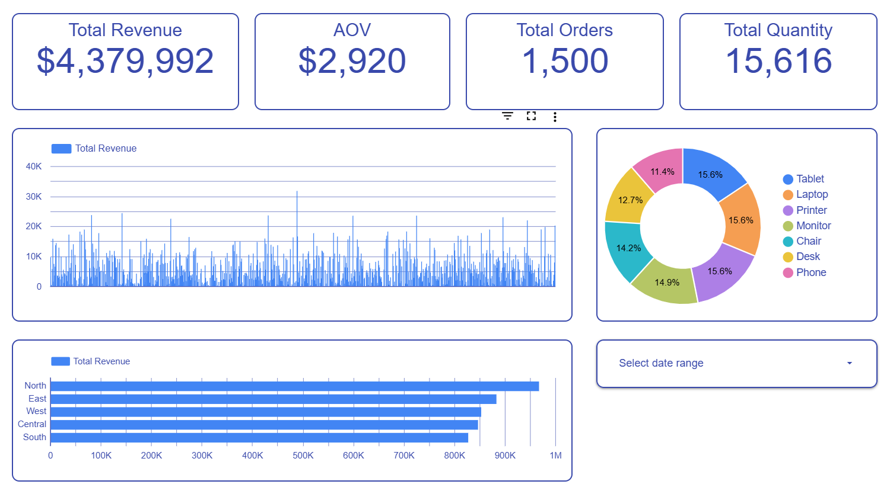

# E-Commerce Sales & Executive Dashboard | Looker Studio

## Project Overview

An interactive e-commerce analytics dashboard developed in **Looker Studio** to monitor sales performance, analyze revenue trends, and evaluate business operations.

The dashboard uses structured transaction data from Google Sheets to provide insights into revenue, average order value, order volume, product category performance, and regional sales distribution.

## Business Objectives

The main objectives of this project are to:

- Monitor overall revenue and sales performance.
- Track Average Order Value (AOV) and order volume.
- Identify top-performing product categories.
- Compare revenue across geographic regions.
- Support data-driven decisions in sales and inventory management.

## Data Sources & Workflow

**Google Sheets** was used as the primary data source and preparation environment.

The workflow consisted of:

1. **Data Collection:** Gathering e-commerce transaction records, product categories, and regional sales data.
2. **Data Preparation:** Cleaning, organizing, and structuring datasets in Google Sheets.
3. **Data Integration:** Connecting the prepared dataset to Looker Studio.
4. **Dashboard Development:** Creating interactive KPI cards, charts, financial metrics, and dynamic filters.

## Tools & Technologies

- **Google Sheets** – Data collection, cleaning, organization, and preparation.
- **Looker Studio** – Data integration, calculated metrics, KPI development, interactive visualizations, and reporting.

## Data Analysis & Preparation

The project involved the following analytical tasks:

- Structured order-level e-commerce transaction data.
- Organized product categories and regional sales records.
- Calculated key business metrics, including Average Order Value (AOV).
- Analyzed revenue distribution across product categories and regions.
- Developed interactive charts and filters for sales performance analysis.

## Key Metrics & KPIs

| KPI | Value | Description |
|---|---:|---|
| Total Revenue | $4,379,992 | Overall revenue generated |
| Average Order Value (AOV) | $2,920 | Average revenue per order |
| Total Orders | 1,500 | Number of customer orders |
| Total Quantity | 15,616 | Total units sold |

Additional analysis includes:

- **Revenue by Region:** Comparison of sales performance across North, East, West, Central, and South regions.
- **Product Category Share:** Revenue distribution across product categories, including tablets, laptops, printers, chairs, and others.

## Dashboard Features

- **Executive KPI Overview:** High-level summary of revenue, AOV, orders, and quantity sold.
- **Revenue Trend Analysis:** Time-series visualization of sales performance over time.
- **Product Category Analysis:** Donut chart showing revenue distribution by product category.
- **Regional Performance:** Horizontal bar chart comparing revenue across geographic regions.
- **Interactive Date Filtering:** Dynamic date range selection for analyzing specific reporting periods.

## Business Value

The dashboard provides a centralized overview of e-commerce performance, enabling business stakeholders to monitor financial results, identify high-performing regions and product categories, and better understand sales trends.

These insights support more informed decisions regarding sales strategies, product demand, and inventory planning.

## Dashboard Preview

## Live Dashboard

[View Interactive Dashboard – Looker Studio](https://datastudio.google.com/reporting/477e8c16-d535-4231-909c-704ae4d478ec/page/LhQ9F)

## Data Confidentiality

This project was developed using anonymized sample/client e-commerce data. Identifying details, proprietary identifiers, and sensitive business information have been masked or modified for portfolio presentation.
