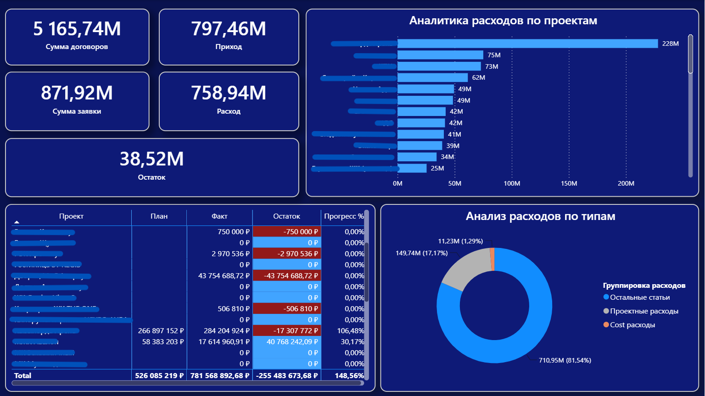

# Project Financial Analytics 

## Project Overview

This project focuses on analyzing project finances, tracking budgets, and monitoring expenses through an interactive Power BI dashboard.

The dashboard provides a centralized view of total contract amounts, incoming cash flow (revenue), expenditures, and remaining balances across multiple projects.

## Business Objective

The main objective is to monitor budget execution, track planned vs. actual costs, evaluate financial performance, and support data-driven decision-making for better financial control and resource allocation.

## Data Sources & Workflow

- **Data Source:** Financial records, project budgets, and transaction data maintained in Google Sheets.
- **Data Preparation:** Google Sheets was used to organize, clean, and structure financial datasets, contracts, and expense categories.
- **Dashboard Development:** The prepared data was integrated into Power BI to develop an interactive dashboard for financial monitoring and reporting.

## Tools & Technologies

- **Google Sheets:** Data collection, organization, cleaning, and initial financial data preparation.
- **Power BI:** Data integration, data modeling, KPI development, data visualization, and interactive financial reporting.

## Data Analysis & Preparation

- Collected and structured project-based financial data.
- Organized datasets in Google Sheets for integration into Power BI.
- Calculated financial variances, including plan vs. actual differences and remaining balances.
- Developed interactive visualizations, tables, and filters to support financial analysis.

## Key Metrics & KPIs

The dashboard tracks the following key performance indicators:

- **Total Contract Amount:** Total value of established project contracts.
- **Revenue / Inflow:** Total incoming cash flow.
- **Total Expenses / Outflow:** Total expenditures across projects.
- **Remaining Balance:** Remaining financial balance after expenses.
- **Plan vs. Actual:** Comparison of planned budgets against actual expenses.
- **Progress (%):** Percentage of budget utilization or project financial progress.

## Dashboard Features

- High-level financial KPI summary cards.
- Expense analysis broken down by individual projects.
- Expense distribution by categories and types.
- Detailed tables comparing planned budgets against actual spending and variances.
- Interactive filters for exploring financial data.
- Clear performance indicators for monitoring budget execution.

## Business Value

The dashboard provides a centralized and transparent view of project finances, helping managers identify budget overruns, monitor spending patterns, evaluate budget utilization, and make informed financial decisions.

## Dashboard Overview

---

## Data Confidentiality

This project was developed using real client data. Certain identifying information, including client-related names and sensitive details, has been anonymized or concealed in the published dashboard screenshot to protect client confidentiality.
